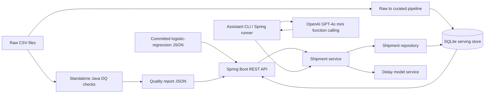

# Supply Chain Intelligence Mini-Platform

An end-to-end take-home assignment implementation in Java 17 and Spring Boot 3.5.16. The included CSV files are the assignment inputs; nothing in this repository depends on the separate LearnCoding project.

## Getting started

The fastest path is Docker Compose (Docker Desktop required):

```bash
docker compose up --build
```

The API is available on port 8080 and the OpenAPI UI is at `/swagger-ui/index.html` (see the `/v3/api-docs` JSON). The service reads the committed model artifact, builds the SQLite serving tables from the included CSVs, and writes the quality report at startup. The assistant is optional; set `OPENAI_API_KEY` to use it.

For local development, install JDK 17+ and Maven 3.6.3+, then:

```bash
mvn test
mvn spring-boot:run
```

Run standalone raw checks without building the SQLite store:

```bash
mvn spring-boot:run -Dspring-boot.run.arguments="--spring.main.web-application-type=none,--app.mode=dq"
```

Train and evaluate the committed model artifact once (never at API startup):

```bash
mvn spring-boot:run -Dspring-boot.run.arguments="--spring.main.web-application-type=none,--app.mode=train"
```

Ask the tool-using assistant from the command line:

```bash
$env:OPENAI_API_KEY="your-key"
mvn spring-boot:run -Dspring-boot.run.arguments="--app.mode=assistant,--assistant.question=Which routes have had the highest average delay?"
```

## Architecture diagram



The API follows controller-service-repository layering: controllers translate HTTP requests, `ShipmentService` owns query/prediction rules, and `ShipmentRepository` owns JDBC access. The assistant calls the same service use cases, rather than calling controller methods directly. The pipeline stages raw CSVs into curated SQLite tables with derived fields. `ports.port_code` is the reference key. `curated_shipments.shipment_id` and `curated_port_events.event_id` are unique; curated records reference valid port codes. The pipeline drops and rebuilds the tables transactionally, making repeated runs idempotent.

## Tech choices

- **Spring Boot 3.5 / Java 17:** Spring MVC provides REST and validation; Java 17 is the baseline runtime. Spring Boot 3.5 requires Java 17 or newer and supports Maven 3.6.3+ ([official requirements](https://docs.spring.io/spring-boot/3.5/system-requirements.html)).
- **SQLite + JDBC:** appropriate for the supplied 5,028 shipments, 25 ports, and 25,000 event rows with no external service. At 100x volume, use PostgreSQL for concurrent ingestion and serving; partition event history and add an analytical warehouse if aggregate workloads grow.
- **Apache Commons CSV:** handles quoted CSV fields and headers consistently.
- **Delay model:** transparent L2-regularized logistic regression implemented in Java; model weights are serialized to JSON and loaded once at service startup. This keeps training/serving simple and avoids native ML runtime dependencies.
- **Assistant:** OpenAI GPT-4o mini through Java's standard `HttpClient`, using function calling. At current list prices ($0.15 / million input tokens, $0.60 / million output tokens), a sample 2,000-in/1,000-out-token turn costs about $0.0009; tool loops and real token counts change this estimate ([model pricing](https://developers.openai.com/api/docs/models/gpt-4o-mini)).
- **Tests:** JUnit 5 covers pure data-quality/business rules; Spring Boot Test with `TestRestTemplate` starts an ephemeral server and exercises real HTTP endpoints.
- **CI:** GitHub Actions runs `mvn verify` on pushes and pull requests.
- **Skipped intentionally:** UI, Kafka, Kubernetes, cloud infrastructure, external database, and automatic deployment. The supplied scale does not need these to demonstrate a working thin slice.

## Data quality summary

`app.mode=dq` reads raw CSVs directly and writes/prints JSON without running the ingestion pipeline. Each check reports dataset, affected count, percentage, severity, detection and recommended action. The brief refers to twelve issues but does not enumerate them; this repo runs 17 explicit checks across duplicates, missing values, invalid timelines/quantities, and broken references. Percentages use each raw table's row count; issue counts overlap.

| Check | Affected rows | Handling |
|---|---:|---|
| Repeated shipment IDs | 56 | Keep first ID during curation; preserve DQ count for review. |
| Repeated event IDs | 206 | Keep first event ID for event serving. |
| Exact duplicate shipment rows | 16 | The count includes each row in an exact-duplicate group; keep one row during curation. |
| Unknown origin / destination references | 222 / 253 | Quarantine shipments with missing or invalid port dimension rows. |
| Unknown event port references | 983 | Quarantine events with no valid matching port dimension row. |
| Missing actual timestamps | 349 | Retain nullable in-flight rows; exclude missing arrivals from outcome metrics and ML labels. |
| Missing shipment attributes | 108 | Preserve nulls and flag; never infer source values. |
| Blank / unsupported status | 54 | Normalize recognized aliases/case; preserve null for review. |
| Noncanonical cargo labels | 261 | Trim and title-case in curated output. |
| Nonpositive shipment quantities | 132 | Quarantine from curated shipments and training rows. |
| Invalid planned/actual timelines | 0 / 0 | Check; quarantine if future data contains invalid chronology. |
| Missing event type or notes | 2,041 | Keep event and nullable descriptive fields. |
| Duplicate port codes / missing port attributes | 0 / 1 | Quarantine duplicate codes; flag incomplete metadata. |
| Invalid port reference row | 0 | Quarantine invalid code or congestion values. |

## API

- `GET /health` — readiness and version.
- `GET /shipments/{id}` — full curated record or structured 404.
- `POST /shipments` — validate and save a new shipment, returning HTTP 201 and its resource URL. API-created rows are stored separately from the raw-data rebuild so they survive pipeline refreshes (and app restarts when the database file or Compose volume is retained).
- `GET /shipments` — filters `origin`, `destination`, `status`, `date_from`, `date_to` (ISO dates), `page`, and `page_size`.
- `GET /routes/{origin}/{destination}/stats` — average delay hours, on-time rate (delay <= 24h), and labeled shipment count.
- `POST /predict-delay` — accept all booking-time features or `{ "shipment_id": "SHP-00421" }`.
- `GET /data-quality/report` — current raw-file checks as JSON.

Errors have a JSON `error.code` and `error.message`. A servlet filter logs every HTTP request as JSON with method, path, status code, and latency.

## ML: evaluation and monitoring

The target is arrival more than 24 hours later than planned. Only fields available at booking enter features: origin, destination, cargo type, container count, weight, and planned transit days. Actual departure, actual arrival, and outcome-derived fields never enter the feature matrix. Training filters use the same validated, unique port dimension as curation. `artifacts/delay-model.json` is the committed artifact; `artifacts/model-metrics.json` records the fixed-seed stratified 75/25 evaluation. The baseline uses 4,105 eligible labeled shipments (3,078 train / 1,027 test). Precision is 0.4169, recall 0.4368, F1 0.4266, AUC 0.5040, and accuracy 0.5209. Its observed quality is close to random, so it is not an operational decision model.

In production, track feature drift/missingness, calibration, precision/recall/AUC by route and month, label delay, and prediction volume. Trigger retraining when drift or delayed-label performance crosses agreed thresholds; validate with a temporal split and human-reviewed canary.

## GenAI assistant

The CLI lets the model choose `query_shipments(filters)`, `get_route_stats(origin, destination)`, and `predict_delay(shipment_id)`. Guardrails restrict the assistant to supply-chain questions, cap each answer at five tool calls, and require tool attribution for factual claims. Tool responses come from curated data and the saved model. Every LLM prompt/request, tool call, tool response, and final answer is appended to `logs/assistant.jsonl`. Production use should add log redaction, access control, and retention limits.

## Production Support Runbook

1. After a deployment, call `/health`, retrieve a known shipment, and fetch `/data-quality/report`; review JSON request logs for latency/5xx changes.
2. **Startup/store failure:** inspect container logs and `DATA_DIR`/`DATABASE_PATH`; check CSV mounts and writable volume. Re-run the standalone DQ report, then restart to rebuild curated tables.
3. **Unexpected route metrics:** confirm route port codes, arrival-label coverage, and DQ findings; rerun the pipeline from the raw CSVs.
4. **Prediction failure:** verify `MODEL_PATH` exists and model artifact is valid. The service loads but does not retrain the artifact at startup.
5. **Assistant failure:** check API key, OpenAI access/network, and `logs/assistant.jsonl`; the core API remains usable without an LLM key.
6. Roll back by redeploying the previous immutable image tag. Before production, add backups and test restores for SQLite, and use versioned schemas.
7. Add metrics/alerting, secrets management, request authentication, log redaction, rate limiting, dependency and image scans, and model version tracking before production.

## CI/CD

GitHub Actions uses Temurin Java 17, runs Checkstyle and `mvn verify` (unit and real-HTTP integration tests), then builds the Docker image for every push and pull request. Merge gates should require this workflow, review, and no high-severity dependency/security findings. A production release should build one immutable image, run staging smoke/health checks, then promote the same image with a canary/rolling deployment. Roll back to the previous image on failed health, latency, or error-rate checks. Registry publishing and deployment credentials are intentionally not configured in this take-home repository. The local repository has no GitHub remote yet, so a live status badge cannot be linked until it is pushed.

## If I had more time

I would inspect conflicting duplicate-ID records, add temporal and route-grouped evaluation, strengthen the feature set with point-in-time port congestion history, calibrate the risk score, and compare against simple baselines. I would add schema migrations, a quarantine export, and prompt-injection tests for the assistant.

## Scaling to production

At 100x, SQLite can remain useful for single-node analytical reads but is a poor fit for concurrent ingest and high availability. Move serving to PostgreSQL, partition port-event history by time, and use a separate warehouse for large scans. Replace full CSV rebuilds with incremental, checkpointed ingestion and an independently scheduled DQ job that reconciles source and curated counts.

For millions of shipments at 24/7 reliability, run stateless API replicas, pool database connections, cache hot route aggregates, and add durable ingestion, backup/restore drills, SLOs, and data-freshness alerts. Version model/features and schema, retrain from point-in-time data, evaluate temporally, deploy in shadow/canary, and retain a tested rollback artifact. Restrict the LLM tool layer with per-user authorization, call budgets, audit retention, and redaction.

## AI assistance

An AI coding assistant helped scaffold the app and tests. I selected the service/data/model boundaries, leakage-safe features, cleaning policies, evaluation split, and production tradeoffs for this submission.
